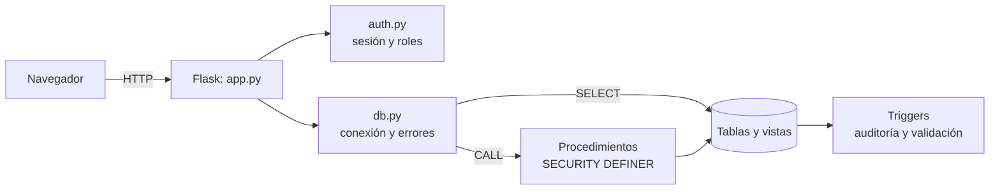
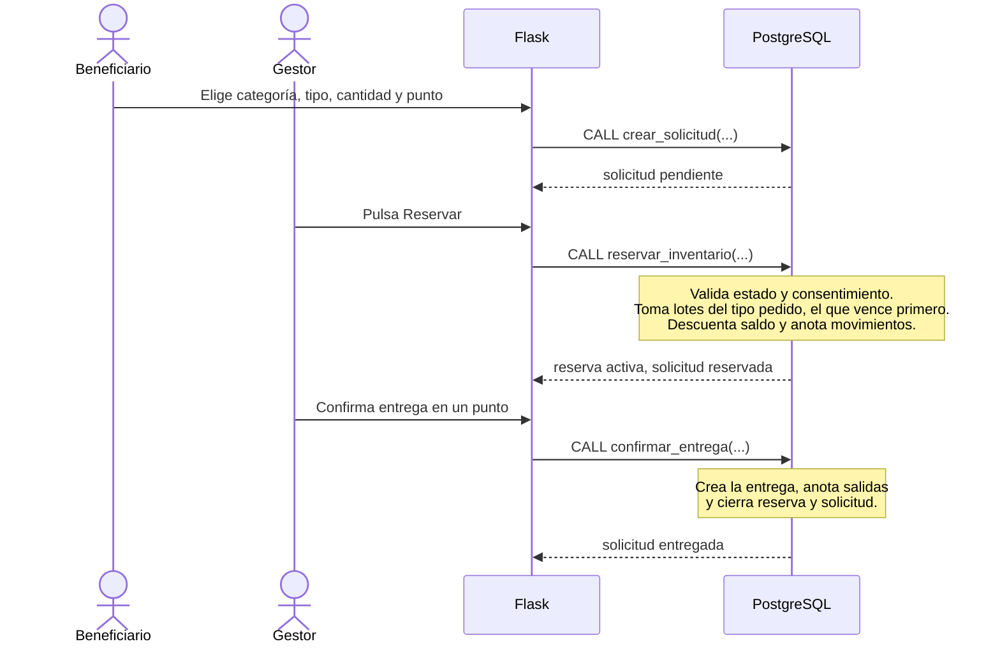

# Manual técnico — Red Alimenta Medellín

Dirigido a quien necesite entender, instalar, mantener o ampliar el sistema. Para usar la aplicación, ver el [manual de usuario](manual_usuario.md). Para la estructura de la base de datos, ver el [diccionario de datos](diccionario_datos.md) y el [modelo entidad-relación](modelo_er.md).

## 1. Visión general

El sistema registra donaciones de alimento, controla el inventario por lotes, recibe solicitudes de beneficiarios, reserva el alimento con la regla **FEFO** (primero vence, primero sale) y deja trazabilidad de cada movimiento.

**Idea central del diseño:** las reglas importantes viven en la **base de datos** 



## 2. Tecnologías

| Componente | Tecnología |
|---|---|
| Base de datos | PostgreSQL 16 o superior (pgAdmin como herramienta) |
| Lenguaje | Python 3.13 |
| Framework web | Flask 3.0.3 |
| Conexión a la base | psycopg2-binary (2.9.10 o superior) |
| Variables de entorno | python-dotenv 1.0.1 |
| Plantillas | Jinja2 (incluido con Flask) |
| Estilos | CSS propio (`static/css/estilo.css`), sin librerías externas; solo tipografías de Google Fonts |

## 3. Estructura del proyecto

```
red-alimenta/
├── app.py                  Rutas de la aplicación (qué pasa en cada pantalla)
├── auth.py                 Decoradores: exigir sesión y exigir rol
├── db.py                   Conexión a PostgreSQL: consultar() y ejecutar()
├── crear_usuarios_demo.py  Pone contraseña (con hash) a los usuarios @alimenta.test
├── probar_conexion.py      Comprueba que la conexión a la base funciona
├── probar_procedimientos.py  Prueba rápida de procedimientos desde Python
├── requirements.txt        Librerías de Python
├── .env                    Datos privados de conexión (NO se sube a git)
├── .env.example            Plantilla para crear el .env
├── templates/              Pantallas HTML (Jinja2)
├── static/css/             Estilos
├── database/
│   ├── setup/              Creación de roles de base de datos
│   ├── migrations/         Estructura y lógica (001 a 017), se ejecutan en orden
│   ├── seeds/              Catálogos y datos de prueba
│   ├── tests/              Pruebas SQL
│   └── queries/            Consultas de ejemplo (simples, JOIN, avanzadas, transacciones)
└── docs/                   Modelo ER, diccionario, matriz, manuales, capturas y evidencias
```

## 4. Configuración

### 4.1 Archivo `.env`

| Variable | Qué es | Ejemplo |
|---|---|---|
| `DB_HOST` | Dónde está PostgreSQL | `localhost` |
| `DB_PORT` | Puerto | `5432` |
| `DB_NAME` | Nombre de la base | `alimenta` |
| `DB_USER` | Rol con el que entra la aplicación | `alimenta_app` |
| `DB_PASSWORD` | Contraseña de ese rol | (la que definiste) |
| `SECRET_KEY` | Llave que firma la sesión. Obligatoria: sin ella la aplicación no arranca | `python -c "import secrets; print(secrets.token_hex(32))"` |

El `.env` está en `.gitignore`: nunca se sube al repositorio.

### 4.2 Roles de base de datos

| Rol | Uso |
|---|---|
| `postgres` | Dueño de los objetos; se usa solo para instalar (migraciones) |
| `alimenta_app` | La aplicación. Puede leer las tablas del negocio y **llamar** a los procedimientos; casi no escribe directamente en las tablas |
| `alimenta_lectura` | Reportes: lee solo las vistas agregadas |

## 5. La aplicación (Python)

### 5.1 `db.py`

| Función | Para qué sirve |
|---|---|
| `consultar(sql, params)` | Ejecuta un `SELECT` y devuelve una lista de diccionarios |
| `ejecutar(sql, params, id_usuario)` | Ejecuta un cambio o un `CALL`. Confirma (`commit`) si sale bien; si falla, deshace (`rollback`) y lanza `ErrorDeNegocio` con un mensaje legible |
| `ErrorDeNegocio` | Error cuyo mensaje sí se puede mostrar a la persona |

Detalles importantes:

- **Consultas parametrizadas:** los valores van siempre en `params`, nunca pegados al texto SQL. Es la defensa contra la inyección SQL.
- **Quién hizo el cambio:** `ejecutar` guarda el `id_usuario` de la sesión en la variable de transacción `app.id_usuario` (`set_config(..., true)`). Los triggers de auditoría la leen para anotar el autor. Ese número sale **siempre de la sesión**, nunca de un formulario.
- **Mensajes:** los errores escritos con `RAISE EXCEPTION` en los procedimientos se muestran tal cual. Los de restricciones (CHECK, UNIQUE, FK, NOT NULL, permisos) se traducen a un mensaje general; cualquier otro muestra "Ocurrió un error inesperado" y el detalle técnico se imprime solo en la terminal.

### 5.2 `auth.py`

- `@login_requerido`: si no hay sesión, redirige a `/entrar`.
- `@rol_requerido("gestor", "administrador")`: además exige alguno de los roles; si no lo tiene, responde **403**.

### 5.3 Sesión y seguridad web

- La sesión guarda `id_usuario`, `nombre` y `roles` en una cookie firmada con `SECRET_KEY`, con `HttpOnly` y `SameSite=Lax`.
- **CSRF:** cada formulario que envía datos lleva un campo oculto `csrf`. Antes de cada petición `POST`, `revisar_csrf` lo compara con el de la sesión; si no coincide, responde **400**.
- Las contraseñas se guardan con hash (`werkzeug.security`), nunca en texto plano.
- Hay páginas de error personalizadas para 400, 403 y 404 (`error.html`).

### 5.4 Rutas

| Ruta | Método | Quién | Qué hace | Objeto de base de datos | Plantilla |
|---|---|---|---|---|---|
| `/` | GET | Con sesión | Tablero de inicio según los roles | Consultas de conteo, `v_alertas_vencimiento` | `inicio.html` |
| `/entrar` | GET, POST | Público | Inicio de sesión | Tablas `usuario`, `usuario_rol` | `entrar.html` |
| `/salir` | POST | Con sesión | Cierra la sesión | — | — |
| `/inventario` | GET | Con sesión | Inventario disponible | `v_inventario_disponible` | `inventario.html` |
| `/solicitudes` | GET | Beneficiario, gestor, administrador | Beneficiario: formulario e historial. Gestión: solicitudes pendientes | Consultas sobre `solicitud`, `lote`, `punto_entrega` | `solicitudes_beneficiario.html`, `solicitudes_gestion.html` |
| `/solicitudes/nueva` | POST | Beneficiario | Crea una solicitud | `crear_solicitud` | — |
| `/solicitudes/<id>/cancelar` | POST | Beneficiario | Cancela su solicitud | `cancelar_solicitud` | — |
| `/solicitudes/<id>/reservar` | POST | Gestor, administrador | Reserva con FEFO | `reservar_inventario` | — |
| `/reservas` | GET | Gestor, administrador | Reservas activas con su detalle | Consultas sobre `reserva` | `reservas.html` |
| `/reservas/<id>/entregar` | POST | Gestor, administrador | Confirma la entrega | `confirmar_entrega` | — |
| `/reservas/<id>/cancelar` | POST | Gestor, administrador | Cancela la reserva | `cancelar_reserva` | — |
| `/entregas` | GET | Gestor, administrador | Últimas 50 entregas con detalle | Consultas sobre `entrega` | `entregas.html` |
| `/lotes` | GET | Donante, gestor, administrador | Formulario y lotes recientes | Consultas sobre `lote`, `tipo_alimento` | `lotes.html` |
| `/lotes/nuevo` | POST | Donante, gestor, administrador | Registra un lote | `registrar_lote` | — |
| `/alertas` | GET | Gestor, administrador | Lotes por vencer y vencidos | `v_alertas_vencimiento` | `alertas.html` |
| `/alertas/marcar-vencidos` | POST | Gestor, administrador | Registra la pérdida de lotes vencidos | `marcar_lotes_vencidos` | — |
| `/admin/catalogos` | GET | Administrador | Listas editables | Consultas de catálogos | `admin_catalogos.html` |
| `/admin/categoria`, `/admin/tipo`, `/admin/unidad`, `/admin/punto` | POST | Administrador | Crear o editar catálogos | `admin_guardar_*` | — |
| `/admin/usuarios` | GET | Administrador | Usuarios y roles, con buscador | Consultas de usuarios | `admin_usuarios.html` |
| `/admin/usuarios/crear` | POST | Administrador | Crea un usuario | `admin_crear_usuario` | — |
| `/admin/usuarios/<id>/estado` | POST | Administrador | Activa o desactiva | `admin_estado_usuario` | — |
| `/admin/usuarios/<id>/rol` | POST | Administrador | Agrega o quita un rol | `admin_asignar_rol`, `admin_quitar_rol` | — |

Las plantillas comparten el diseño de `base.html` (menú según el rol, mensajes y pie de página). `_detalle.html` es una pieza reutilizable: el desplegable "Ver detalle" de Reservas y Entregas.

## 6. La base de datos

### 6.1 Cómo se protege

1. **Restricciones** (`CHECK`, `UNIQUE`, llaves foráneas): cantidades positivas, saldo entre 0 y la cantidad inicial, estados válidos, tipo de alimento dentro de su categoría.
2. **Procedimientos `SECURITY DEFINER`:** la aplicación no escribe en las tablas del negocio; llama a procedimientos que primero comprueban quién es y qué puede hacer. Todos fijan `search_path = public, pg_temp`.
3. **Triggers:** auditoría de cambios sensibles, validación del estado de las reservas y del lote al reservar, y protección del historial (`trg_no_borrar`, `trg_solo_agregar`).
4. **Bloqueos (`FOR UPDATE`)** al reservar, para que dos reservas simultáneas no tomen el mismo saldo.

### 6.2 Flujo principal: solicitar, reservar y entregar



### 6.3 Flujo de cancelación

- **El beneficiario cancela su solicitud** (`cancelar_solicitud`): solo la suya. Si estaba pendiente, cambia de estado. Si estaba reservada, además devuelve el saldo a cada lote, anota las liberaciones y cierra la reserva.
- **El gestor cancela una reserva** (`cancelar_reserva`): devuelve el saldo, anota liberaciones, marca la reserva y cierra la solicitud si no le queda otra reserva.

### 6.4 Migraciones

Son archivos SQL numerados que construyen la base paso a paso. Se ejecutan **una sola vez cada una y en orden**.

| N.º | Archivo | Propósito |
|---|---|---|
| 001 | `001_tablas_base.sql` | Roles, usuarios, donantes, sedes, categorías, unidades y beneficiarios |
| 002 | `002_tablas_inventario.sql` | Lotes, solicitudes, reservas, entregas, movimientos y auditoría |
| 003 | `003_indices_y_vistas.sql` | Índices y 4 vistas |
| 004 | `004_procedimiento_reservar.sql` | Reserva FEFO (primera versión) |
| 005 | `005_procedimientos_entrega_cancelacion.sql` | Confirmar entrega y cancelar reserva |
| 006 | `006_funciones_y_triggers.sql` | Funciones y triggers de auditoría y validación |
| 007 | `007_comuna_beneficiario.sql` | Comuna del beneficiario |
| 008 | `008_reportes.sql` | Reportes y trazabilidad de lotes |
| 009 | `009_roles_y_permisos.sql` | Permisos mínimos |
| 010 | `010_lo_que_faltaba.sql` | Puntos de entrega, consentimiento, lotes vencidos, historial protegido |
| 011 | `011_crear_solicitud.sql` | Procedimiento para crear solicitudes (primera versión) |
| 012 | `012_usuario_donante.sql` | Vínculo usuario–donante y `registrar_lote` para donantes |
| 013 | `013_tipos_y_punto_solicitud.sql` | Tipos de alimento, punto en la solicitud, Carnes y Pescados separadas |
| 014 | `014_solicitud_con_tipo_punto_y_cancelacion.sql` | Solicitud con tipo y punto; reserva por tipo; cancelación del beneficiario |
| 015 | `015_registrar_lote_con_tipo.sql` | `registrar_lote` con tipo |
| 016 | `016_administracion.sql` | Procedimientos de administración y auditoría de catálogos |
| 017 | `017_corregir_reserva_consentimiento.sql` | Restituye la exigencia de consentimiento al reservar |

**Reglas para escribir una migración nueva**

1. **Nunca edites una migración ya ejecutada.** Crea una nueva con el siguiente número.
2. Envuélvela en `BEGIN; … COMMIT;` para que, si algo falla, no quede a medias.
3. **Cuidado con `CREATE OR REPLACE PROCEDURE`:** reemplaza también los atributos, como `SECURITY DEFINER`. Si el procedimiento original los tenía, vuelve a indicarlos en la nueva definición. Este descuido causó dos errores en el proyecto: la pérdida de permisos al reservar y la pérdida de la verificación de consentimiento.
4. Cuando cambies un procedimiento, **parte de su última versión**, no de la primera.
5. Si cambia el nombre de un parámetro, hay que borrar el procedimiento (`DROP PROCEDURE`) y crearlo de nuevo.
6. Concede `EXECUTE` a `alimenta_app` y revoca a `PUBLIC`.
7. Agrega una prueba en `database/tests/`.

## 7. Pruebas

Las pruebas SQL están en `database/tests/` y se ejecutan en el Query Tool de pgAdmin. La mayoría se deshacen solas (`ROLLBACK`) y muestran el resultado en la pestaña **Messages** o en una tabla. Los casos manuales de la interfaz están en la [matriz de trazabilidad](matriz_trazabilidad.md#3-casos-de-prueba-manuales-interfaz).

## 8. Instalación

Los pasos completos, en el orden correcto, están en el [README](../README.md).

## 9. Mantenimiento

### 9.1 Copia de seguridad

En una terminal (ajusta la ruta de PostgreSQL a tu instalación):

```
pg_dump -U postgres -d alimenta -F c -f alimenta_respaldo.backup
```

Para restaurar: crear una base vacía y ejecutar `pg_restore -U postgres -d alimenta alimenta_respaldo.backup`.

### 9.2 Tareas frecuentes

| Quiero… | Qué hacer |
|---|---|
| Agregar un tipo, categoría, unidad o punto de entrega | Entrar como administrador a **Catálogos** |
| Agregar un usuario o cambiar un rol | Entrar como administrador a **Usuarios** |
| Agregar una pantalla | Crear la ruta en `app.py` con su decorador de rol, la plantilla en `templates/` y, si cambia datos, un procedimiento en una migración nueva |
| Agregar un rol nuevo | Insertarlo en la tabla `rol`, crear las rutas con `@rol_requerido` y decidir su opción de menú en `base.html` |

### 9.3 Problemas frecuentes

| Síntoma | Causa probable | Solución |
|---|---|---|
| `Falta SECRET_KEY` al iniciar | El `.env` no existe o no tiene la llave | Crear el `.env` desde `.env.example` y completar `SECRET_KEY` |
| `password authentication failed` | Contraseña de `DB_PASSWORD` distinta a la del rol | Repetir `ALTER ROLE alimenta_app PASSWORD '…'` y actualizar el `.env` |
| `relation … does not exist` | Falta ejecutar alguna migración | Revisar que se ejecutaron todas, en orden |
| "No tienes permiso para hacer esta operación" | Un procedimiento perdió `SECURITY DEFINER` o falta un `GRANT` | Revisar con `SELECT proname, prosecdef FROM pg_proc WHERE proname = '…'` |
| Error 400 al enviar un formulario | Sesión caducada o formulario sin token CSRF | Volver a iniciar sesión; verificar que el formulario lleve el campo `csrf` |
| La lista de tipos sale vacía al solicitar | No hay inventario de ningún tipo | Registrar lotes como donante o gestor |

## 10. Limitaciones y mejoras posibles

- **Una solicitud lleva un solo tipo de alimento.** La base ya admite varios (`solicitud_detalle` permite varias filas y `reservar_inventario` recorre todas); faltaría el formulario con varias líneas.
- **No hay recuperación de contraseña.** Un administrador puede crear usuarios, pero no restablecer contraseñas.
- **Inventario y Alertas muestran la categoría, no el tipo.**
- **Los reportes (vistas `v_reporte_*`) y la auditoría se consultan con SQL;** no tienen pantalla.
- **`reservar_inventario` no verifica el rol de quien la llama:** confía en que la aplicación ya lo hizo (la ruta exige gestor o administrador). `confirmar_entrega` y `cancelar_reserva` sí lo verifican dentro de la base; hacer lo mismo con la reserva sería un endurecimiento sencillo.
- **La aplicación arranca con `debug=True`** (útil para desarrollar, pero muestra detalles de errores). Para un uso real debe ejecutarse con un servidor de producción y `debug` desactivado.
- Todos los datos son ficticios.
