# Manual de usuario — Red Alimenta Medellín

**Red Alimenta Medellín** conecta a quienes tienen alimento que donar (tiendas, panaderías, restaurantes) con las personas que lo necesitan, y se asegura de que lo que está por vencer se entregue primero.

Este manual explica, paso a paso, cómo usar la aplicación según tu rol. Ve directo a la sección que te corresponde:

| Si eres… | Ve a la sección |
|---|---|
| Una persona que solicita alimento (**beneficiario**) | [3. Beneficiario](#3-beneficiario) |
| Una organización que dona alimento (**donante**) | [4. Donante](#4-donante) |
| Quien organiza las entregas (**gestor**) | [5. Gestor](#5-gestor) |
| Quien administra la red (**administrador**) | [6. Administrador](#6-administrador) |

---

## 1. Conceptos básicos

| Palabra | Qué significa |
|---|---|
| **Lote** | Una tanda de alimento donada, con su cantidad y su fecha de vencimiento |
| **Categoría** | El grupo grande del alimento: Bebidas, Lácteos, Carnes, Pescados… |
| **Tipo** | Lo específico dentro de la categoría. En Bebidas: Agua, Gaseosa, Jugo… |
| **Solicitud** | El pedido de alimento que hace un beneficiario |
| **Reserva** | El alimento que se aparta para una solicitud |
| **Punto de entrega** | El sitio donde el beneficiario recoge su alimento |
| **Primero vence, primero sale** | El sistema siempre aparta primero el alimento que vence antes, para que no se pierda |

**Estados de una solicitud**

| Estado | Qué significa para ti |
|---|---|
| Pendiente | Tu pedido está esperando que un gestor lo revise |
| Reservada | Ya hay alimento apartado para ti. Puedes ir a recogerlo al punto de entrega que elegiste |
| Entregada | Ya recibiste tu alimento |
| Cancelada | La solicitud se canceló y el alimento volvió al inventario |

---

## 2. Entrar y salir

### Entrar

1. Abre la aplicación en el navegador.
2. Escribe tu **correo** y tu **contraseña**.
3. Pulsa **Entrar**.

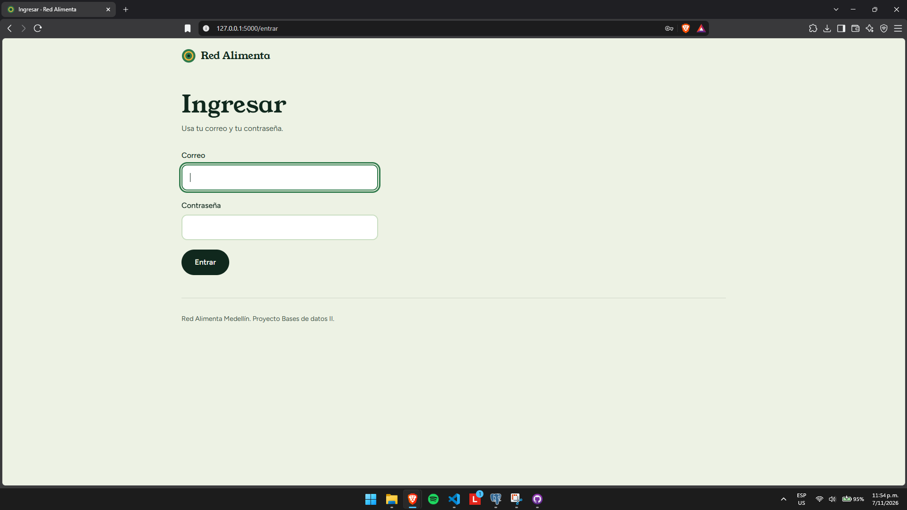

Si te equivocas verás el mensaje "Correo o contraseña incorrectos". Inténtalo de nuevo. Por ahora la aplicación no tiene una opción para recuperar la contraseña. Si la olvidaste, consulta con la persona que administra el sistema.

### El menú

Arriba verás el menú. **Solo aparecen las opciones de tu rol**, así que no te preocupes si no ves las de otras personas.

| Opción | Beneficiario | Donante | Gestor | Administrador |
|---|:---:|:---:|:---:|:---:|
| Inicio | ✔ | ✔ | ✔ | ✔ |
| Inventario | ✔ | ✔ | ✔ | ✔ |
| Registrar lote | | ✔ | ✔ | ✔ |
| Solicitudes | ✔ | | ✔ | ✔ |
| Alertas | | | ✔ | ✔ |
| Reservas | | | ✔ | ✔ |
| Entregas | | | ✔ | ✔ |
| Catálogos | | | | ✔ |
| Usuarios | | | | ✔ |

### Salir

Pulsa **Salir**, al final del menú. Hazlo siempre que uses un computador que no es tuyo.

### El inicio

La primera pantalla es tu resumen. Cada rol ve datos distintos, y los números son enlaces: pulsa uno para ir a esa pantalla.

---

## 3. Beneficiario

### 3.1 Tu inicio

Verás cuántas solicitudes tienes **pendientes**, **listas para recoger**, **entregadas** y **canceladas**. Si tienes alimento reservado, aparece un recuadro que dice **dónde recogerlo**.

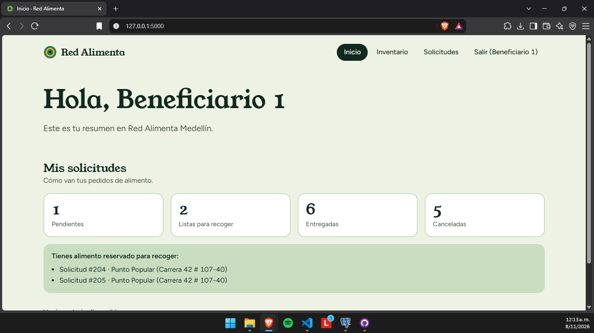

### 3.2 Pedir alimento

1. En el menú, pulsa **Solicitudes**.
2. **Elige la categoría** (por ejemplo, Bebidas).
3. **Elige el tipo** (por ejemplo, Agua). La lista se llena sola con lo que hay disponible en esa categoría, y junto a cada tipo ves cuánto hay.
4. Escribe la **cantidad** que necesitas.
5. **Elige el punto de entrega**, que es donde vas a recoger. Si tu comuna tiene un punto, ya aparece marcado, pero puedes cambiarlo.
6. Pulsa **Enviar solicitud**.

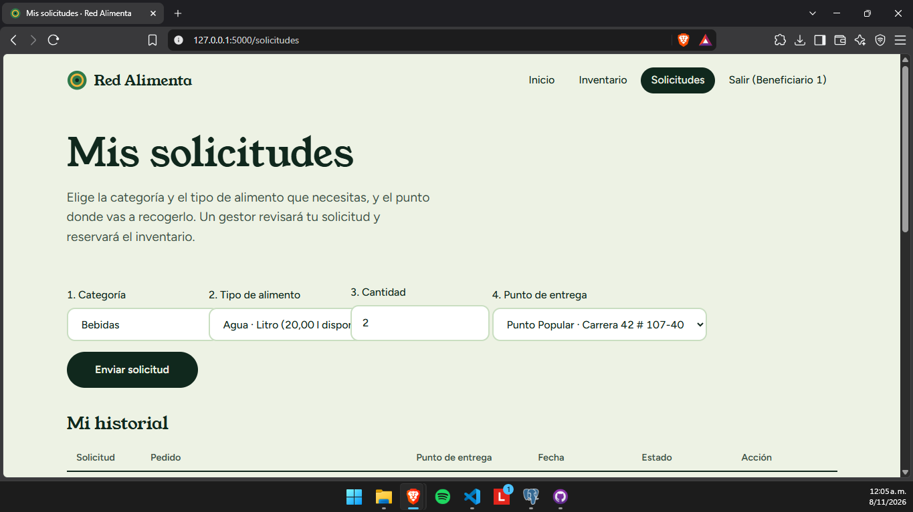

Verás el mensaje "Solicitud creada" y tu pedido aparecerá en **Mi historial** como *pendiente*.

**Si no aparece el tipo que buscas**, es porque hoy no hay inventario de él. Inténtalo otro día o elige otro tipo.

### 3.3 Seguir tu pedido

En **Mi historial** ves tus últimas 20 solicitudes con su pedido, su punto de entrega, su fecha y su estado.

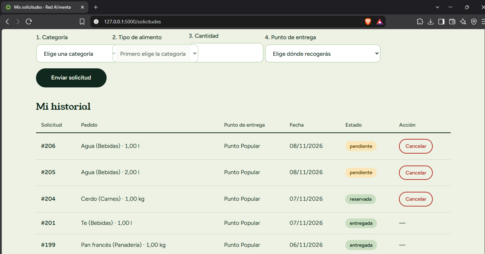

Cuando una solicitud pase a **reservada**, ve al punto de entrega que elegiste para recoger tu alimento.

### 3.4 Cancelar una solicitud

Si ya no necesitas el alimento, cancélalo para que otra persona pueda recibirlo.

1. En **Mi historial**, busca la solicitud.
2. Pulsa **Cancelar** (solo aparece en las solicitudes pendientes o reservadas).
3. Confirma en el mensaje que aparece.

La solicitud pasa a *cancelada* y, si ya estaba reservada, el alimento vuelve al inventario.

### 3.5 Mensajes que puedes ver

| Mensaje | Qué hacer |
|---|---|
| "Debes aceptar el tratamiento de tus datos antes de solicitar" | Falta tu consentimiento de datos. Habla con quien te registró |
| "Tu perfil de beneficiario no está activo" | Tu perfil está suspendido o retirado. Consulta con la organización |
| "Debes elegir un punto de entrega" | Elige un punto en la última lista del formulario |
| "La solicitud ya no se puede cancelar" | Ya fue entregada o cancelada |

---

## 4. Donante

### 4.1 Tu inicio

Muestra cuántos lotes ha registrado tu organización, cuántos aún tienen inventario y cuántos vencen en 3 días o menos.

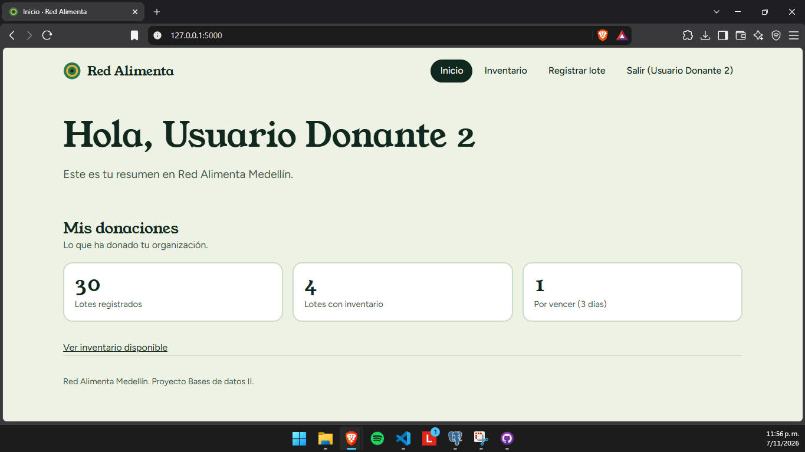

### 4.2 Registrar una donación

1. En el menú, pulsa **Registrar lote**.
2. **Sede:** elige la sede desde donde donas.
3. **Categoría:** elige el grupo del alimento.
4. **Tipo de alimento:** elige el tipo exacto. Si no está, elige **Otro** y describe el alimento en el siguiente campo.
5. **Descripción:** escribe qué es (por ejemplo, "Botellas de agua de 600 ml").
6. **Cantidad** y **Unidad:** cuánto donas y cómo se mide (kilogramos, litros, unidades…).
7. **Vence el:** la fecha de vencimiento del producto.
8. Pulsa **Registrar lote**.

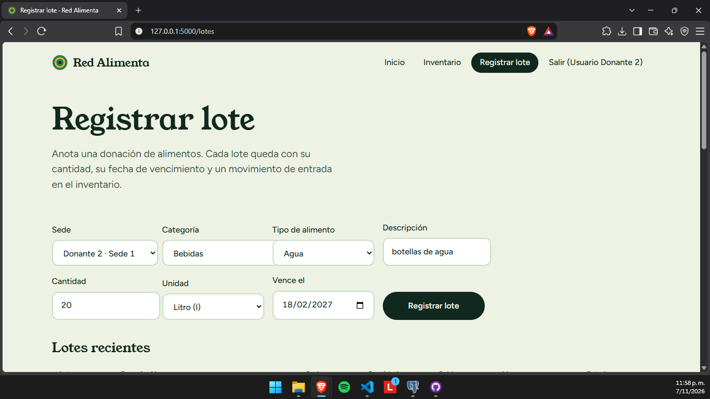

El lote aparece en **Lotes recientes** y entra al inventario. No se pueden registrar alimentos que ya vencieron.

### 4.3 Ver el inventario

En **Inventario** ves todo lo que hay disponible, con su origen, su categoría, su saldo y su fecha de vencimiento.

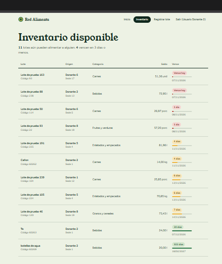

### 4.4 Mensajes que puedes ver

| Mensaje | Qué hacer |
|---|---|
| "La sede no pertenece a tu organización donante" | Elige una de tus propias sedes |
| "Escribe una cantidad válida, mayor que cero" | Escribe una cantidad mayor que cero |

---

## 5. Gestor

El gestor revisa los pedidos, aparta el alimento, entrega y cuida que nada se pierda.

### 5.1 Tu inicio

Muestra lo que necesita atención: solicitudes pendientes, reservas por entregar, lotes por vencer, lotes vencidos sin registrar y entregas del mes. Un número en **rojo** significa que hay algo urgente.

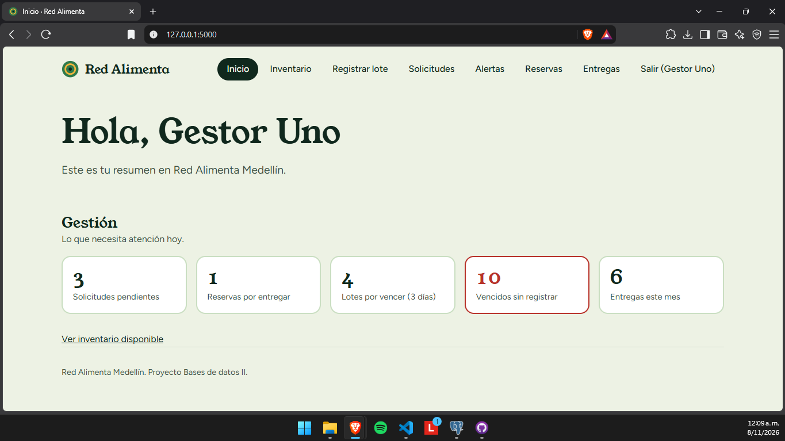

### 5.2 Reservar alimento para una solicitud

1. En el menú, pulsa **Solicitudes**.
2. Verás las solicitudes pendientes: quién las pidió, qué pidió, **en qué punto quiere recoger** y cuándo.
3. Pulsa **Reservar** en la que quieras atender.

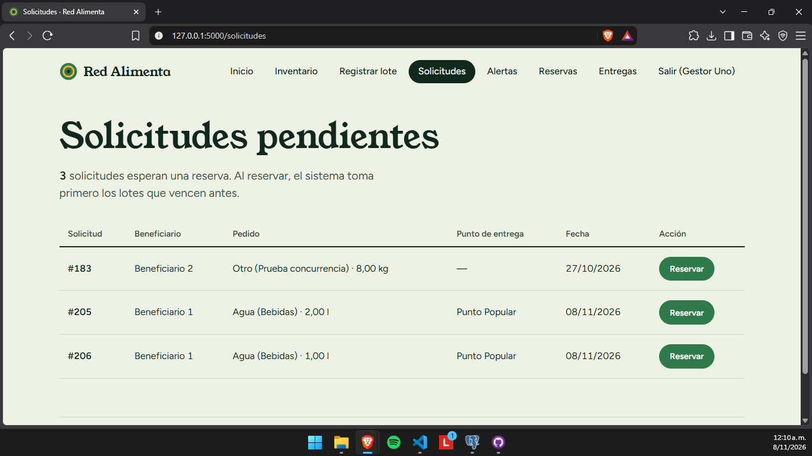

El sistema aparta solo el alimento que vence primero. La solicitud pasa a *reservada* y aparece en **Reservas**.

Mensajes posibles:

| Mensaje | Qué significa |
|---|---|
| "Inventario insuficiente de «Agua»: faltan 3" | No hay suficiente de ese tipo. No se reservó nada. Espera nuevas donaciones |
| "El beneficiario … no ha dado su consentimiento" | No se puede reservar hasta que acepte el tratamiento de datos |
| "La solicitud … no está pendiente" | Otra persona ya la atendió |

### 5.3 Confirmar la entrega

1. En el menú, pulsa **Reservas**.
2. Si quieres ver todo lo que pidió la persona, pulsa **Ver lo que pidió**: se abre un recuadro con el beneficiario, el punto que eligió, lo que pidió y los lotes asignados.
3. Revisa el **punto de entrega**. Ya aparece marcado el que eligió el beneficiario; cámbialo solo si la entrega se hace en otro sitio.
4. Si quieres, escribe una **observación**.
5. Pulsa **Confirmar entrega**.

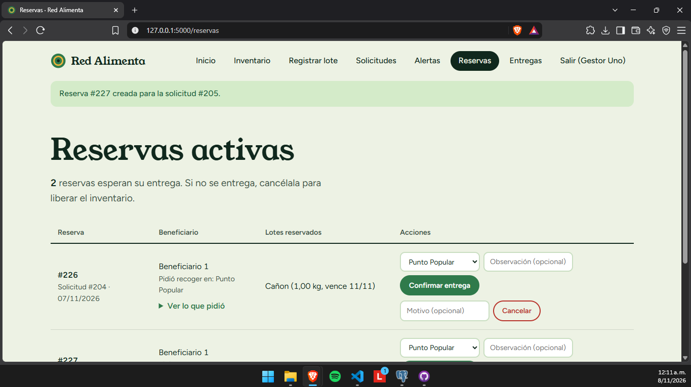

### 5.4 Cancelar una reserva

Si el beneficiario no llega o ya no la necesita, pulsa **Cancelar** en la reserva. El alimento vuelve al inventario para otras personas.

### 5.5 Ver las entregas hechas

En **Entregas** están las últimas 50 entregas. Pulsa **Ver detalle** en cualquiera para ver quién recibió, qué pidió, de qué lotes salió, qué gestor la confirmó y en qué punto.

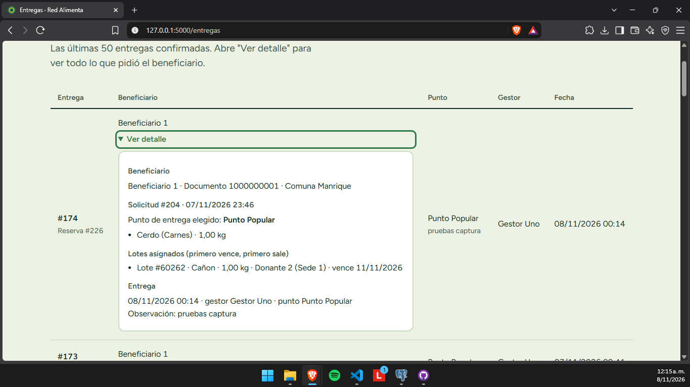

### 5.6 Alertas de vencimiento

En **Alertas** ves dos listas:

- **Vencen en 3 días o menos:** lotes que conviene entregar pronto.
- **Vencidos sin registrar como pérdida:** lotes que ya pasaron su fecha. Pulsa **Registrar pérdida de N lotes** para dejarlos en cero y anotar el movimiento en el historial.

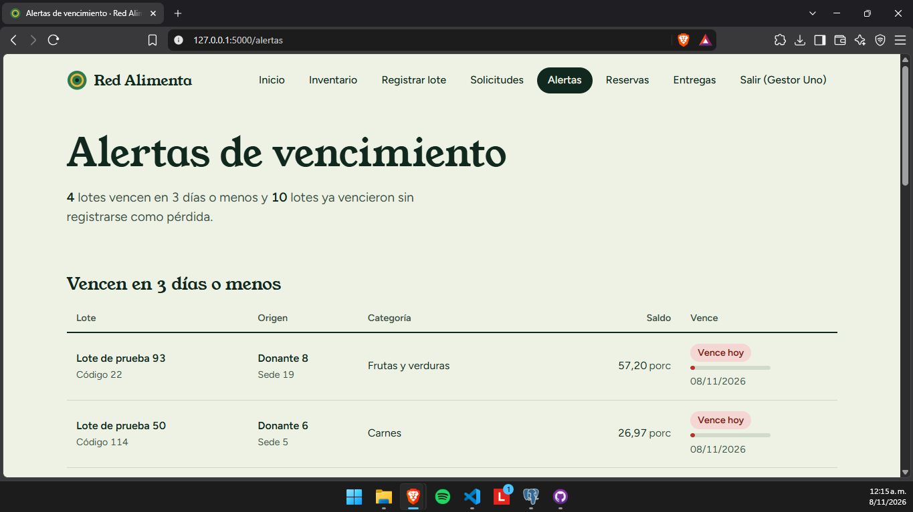

---

## 6. Administrador

El administrador tiene todo lo del gestor y además administra las listas de la aplicación y las personas que la usan.

### 6.1 Tu inicio

Muestra el bloque de **Gestión** y un bloque de **Administración**, con los usuarios activos, los beneficiarios, los donantes, los puntos de entrega y los lotes con inventario.

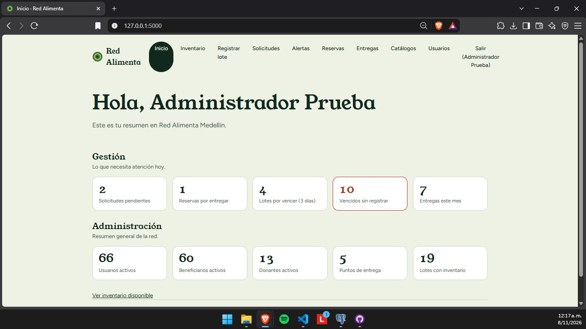

### 6.2 Catálogos

En **Catálogos** se administran cuatro listas. En cada una puedes **editar** una fila (escribe y pulsa **Guardar**) o **agregar** una nueva con el formulario de abajo.

| Lista | Para qué sirve | Notas |
|---|---|---|
| **Categorías** | Los grupos grandes de alimentos | Solo cambia el nombre |
| **Tipos de alimento** | Lo específico que elige el beneficiario | Cada tipo pertenece a una categoría y no se puede cambiar después. Un tipo **desactivado** deja de aparecer en los formularios |
| **Unidades** | Cómo se mide: kilogramo, litro… | Nombre y abreviatura |
| **Puntos de entrega** | Sitios donde se recoge el alimento | Un punto **desactivado** deja de ofrecerse |

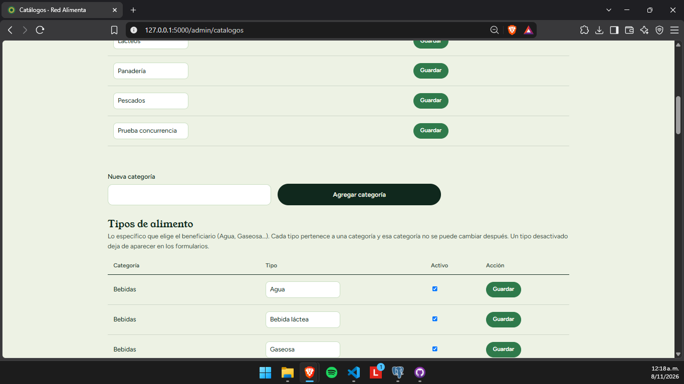

**Ejemplo: agregar el tipo "Té" a Bebidas.** En la sección *Tipos de alimento*, elige la categoría **Bebidas**, escribe **Té** en *Nuevo tipo* y pulsa **Agregar tipo**. Desde ese momento se puede elegir al registrar lotes.

### 6.3 Usuarios y roles

En **Usuarios** puedes:

1. **Buscar** una persona por nombre o correo.
2. **Crear un usuario:** escribe nombre, correo, una contraseña de al menos 8 caracteres y elige el rol. Si es *donante*, elige también su organización. Pulsa **Crear usuario**.
3. **Activar o desactivar** a alguien con el botón de su fila. Un usuario desactivado no puede entrar, pero su historial se conserva.
4. **Quitar un rol** con el botón **Quitar …** de su fila (te pide confirmación).
5. **Agregar un rol** con la lista **Agregar rol…**. Para *donante*, elige también la organización.

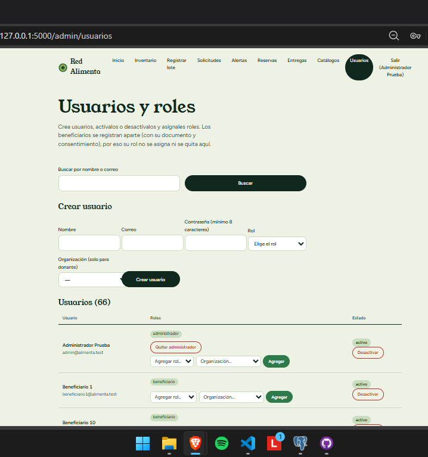

**Reglas de protección:**

- No puedes desactivar tu propio usuario ni quitarte el rol de administrador.
- Siempre debe quedar al menos un administrador activo.
- El rol de *beneficiario* no se asigna ni se quita aquí: los beneficiarios se registran con su documento y su consentimiento de datos.

---

## 7. Preguntas frecuentes

**¿Por qué no veo una opción del menú?**
Porque tu rol no la usa. Cada persona ve solo lo suyo. Si necesitas una opción más, pídele a un administrador que te agregue el rol.

**¿Por qué no aparece el tipo de alimento que busco al solicitar?**
Porque hoy no hay inventario de ese tipo, o el administrador lo desactivó.

**¿Puedo pedir varios tipos de alimento a la vez?**
Cada solicitud lleva un tipo. Para pedir otro, haz una solicitud nueva.

**¿Qué pasa con el alimento que vence antes de entregarse?**
El gestor lo ve en **Alertas** y, cuando vence, registra la pérdida. Por eso el sistema siempre aparta primero lo que vence antes.

**¿Se puede borrar algo?**
No. Para proteger la trazabilidad, los lotes, solicitudes, reservas y entregas no se borran; se cancelan o cambian de estado, y todo queda en el historial.

**La pantalla muestra un error "403".**
Intentaste entrar a una pantalla que no es de tu rol. Vuelve a **Inicio**.

**Perdí mi contraseña.**
Por ahora la aplicación no tiene una opción para recuperarla. Consulta con la persona que administra el sistema.

---

## Anexo: lista de capturas de pantalla

Guarda cada captura como PNG en la carpeta `docs/capturas/` con **exactamente** el nombre indicado; el manual las muestra solas.

| N.º | Nombre del archivo | Con qué usuario | Qué debe verse |
|---|---|---|---|
| 01 | `01_ingreso.png` | (sin ingresar) | Pantalla de ingreso |
| 02 | `02_inicio_beneficiario.png` | beneficiario1@alimenta.test | Inicio, con el bloque "Mis solicitudes" (idealmente con una solicitud reservada para ver el recuadro de recoger) |
| 03 | `03_solicitar_alimento.png` | beneficiario1@alimenta.test | Formulario con la categoría elegida y la lista de tipos abierta |
| 04 | `04_historial_solicitudes.png` | beneficiario1@alimenta.test | "Mi historial" con el botón **Cancelar** visible |
| 05 | `05_inicio_donante.png` | donante2@alimenta.test | Inicio con "Mis donaciones" |
| 06 | `06_registrar_lote.png` | donante2@alimenta.test | Formulario Registrar lote con categoría y tipo elegidos |
| 07 | `07_inventario.png` | cualquiera | Inventario disponible |
| 08 | `08_inicio_gestor.png` | gestor1@alimenta.test | Inicio con el bloque "Gestión" |
| 09 | `09_solicitudes_pendientes.png` | gestor1@alimenta.test | Solicitudes pendientes con la columna "Punto de entrega" |
| 10 | `10_reservas.png` | gestor1@alimenta.test | Reservas activas con la lista de punto ya marcada |
| 11 | `11_reservas_detalle.png` | gestor1@alimenta.test | "Ver lo que pidió" abierto |
| 12 | `12_entregas.png` | gestor1@alimenta.test | Lista de entregas |
| 13 | `13_entregas_detalle.png` | gestor1@alimenta.test | "Ver detalle" abierto |
| 14 | `14_alertas.png` | gestor1@alimenta.test | Alertas de vencimiento |
| 15 | `15_inicio_administrador.png` | admin@alimenta.test | Inicio con "Gestión" y "Administración" |
| 16 | `16_catalogos.png` | admin@alimenta.test | Catálogos (sección de tipos de alimento) |
| 17 | `17_usuarios.png` | admin@alimenta.test | Usuarios y roles |

Opcional: una captura de cualquier pantalla desde el celular, para mostrar que la aplicación se adapta (`18_celular.png`).
