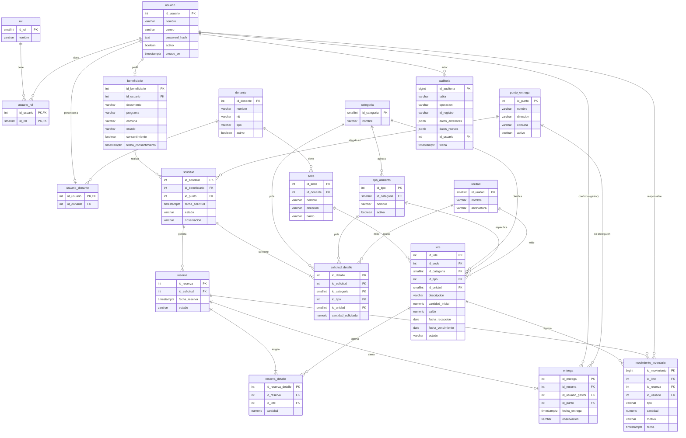

# Modelo entidad-relación — Red Alimenta Medellín

Diagrama de la base de datos `alimenta` (PostgreSQL), actualizado con las migraciones 001 a 017.

**Novedades frente a la versión anterior:**

| Elemento nuevo | Para qué sirve |
|---|---|
| `punto_entrega` | Sitios donde se recoge el alimento. Lo elige el beneficiario al solicitar (`solicitud.id_punto`) y el gestor confirma el punto real al entregar (`entrega.id_punto`). |
| `usuario_donante` | Vincula cada usuario con rol *donante* con su organización, para que solo registre lotes en sus propias sedes. |
| `tipo_alimento` | Tipos específicos dentro de cada categoría (Bebidas → Agua, Gaseosa…). El lote y el detalle de la solicitud guardan el tipo. |
| Categorías separadas | "Carnes y pescados" se separó en **Carnes** y **Pescados**. |

## Diagrama

Para verlo: abrir este archivo en VS Code con la extensión *Markdown Preview Mermaid Support*, o pegar el bloque en <https://mermaid.live> y exportar la imagen (PNG o SVG) para el informe.

## Cómo leerlo

- **Personas y roles:** `usuario` se relaciona con `rol` por medio de `usuario_rol` (un usuario puede tener varios roles). Un usuario con perfil de beneficiario tiene una fila en `beneficiario`; uno con rol *donante* tiene una fila en `usuario_donante`.
- **Donantes e inventario:** `donante` → `sede` → `lote`. Cada lote tiene categoría, tipo y unidad. La pareja (tipo, categoría) está protegida por una llave foránea compuesta: no se puede guardar "Agua" dentro de "Lácteos".
- **Solicitar y recoger:** `beneficiario` → `solicitud` (con el `punto_entrega` elegido) → `solicitud_detalle` (tipo y cantidad pedidos). Al reservar nace una `reserva` con su `reserva_detalle`, que dice de qué lotes sale el alimento (el que vence primero sale primero). Al entregar se crea la `entrega`, que registra gestor y punto.
- **Trazabilidad:** cada entrada, reserva, liberación, salida y vencimiento queda en `movimiento_inventario`. Los cambios sensibles quedan en `auditoria`. Ambas tablas son de solo agregar: no se pueden modificar ni borrar.
- **Relaciones opcionales (`o|` y `o{`):** `solicitud.id_punto` es opcional en la base de datos porque existen solicitudes anteriores a la 013; la aplicación lo exige en toda solicitud nueva.
